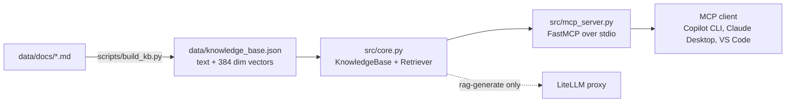

# Architecture

## Layout

| Path | Role |
|---|---|
| `src/config.py` | Typed config. Precedence is env vars, then `config/*.json`, then defaults |
| `src/core.py` | Loads the KB, embeds the query, cosine similarity, optional LLM answer |
| `src/mcp_server.py` | Registers the `rag-search` and `rag-generate` tools |
| `src/main.py` | Entry point, wires everything and starts the server |
| `scripts/build_kb.py` | Chunks the markdown and writes the KB file |
| `data/docs/` | Source documents (three samples included) |
| `deployment/` | Dockerfile and Kubernetes manifest |
| `tests/` | Unit tests and a real stdio round trip against the server |

## How a query flows

1. The client calls `rag-search` with a question.
2. The query is embedded with the same model that embedded the chunks.
3. Cosine similarity is computed against every chunk.
4. Chunks under `min_similarity_threshold` are dropped, the top `top_k` are returned.
5. `rag-generate` then sends those chunks to the LLM and returns the answer plus its sources.

## Design choices

The KB is one JSON file loaded into memory. That is plenty for thousands of chunks and keeps the service stateless. When the corpus outgrows memory, swap `KnowledgeBase` for a vector database such as Qdrant or pgvector and keep the rest.

Embeddings run locally with fastembed, so documents never leave the machine. Only `rag-generate` talks to an LLM, and it is off unless `LITELLM_KEY` is set.

The container runs as a non root user with a read only filesystem. The key comes from a Kubernetes secret, never from the image.
